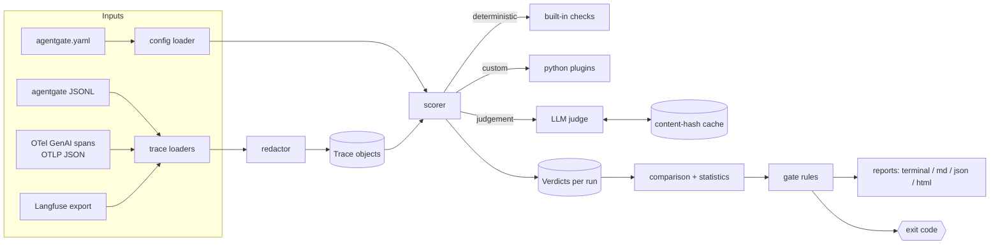
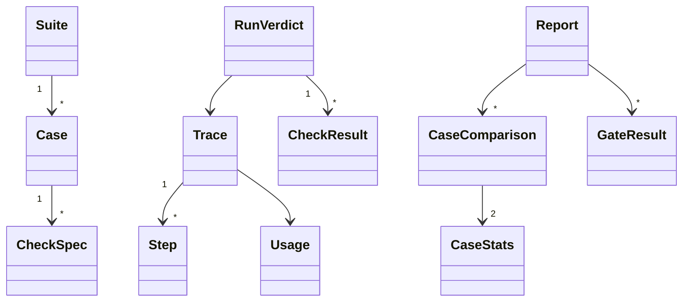

# 02 — Design spec

Status: approved for v0.1 · Stage 2 of 6

## 1. Scope

**In scope (v0.1)**

- Load recorded agent runs ("traces") from: agentgate JSONL (native), OpenTelemetry
  GenAI spans (OTLP/JSON file export), and Langfuse trace export JSON (best effort).
- A suite file (`agentgate.yaml`) declaring cases, checks, judge settings, pricing,
  redaction and gate rules.
- Deterministic checks (11 built-in types), custom Python checks, an LLM-judge check.
- `check` command: score one set of traces; absolute gates only.
- `compare` command: score baseline and candidate, compute statistics, label each
  case, apply gates, write reports, exit with a gate-derived code.
- Reports: terminal, Markdown, JSON, self-contained HTML.
- A reusable GitHub composite action and the repo's own CI.
- An offline demo (support agent, baseline / good change / bad change).

**Out of scope**: see non-goals in `01-brainstorm.md`.

## 2. Architecture



Package layout (`src/agentgate/`):

| Module | Responsibility |
|---|---|
| `models.py` | Pydantic data model (trace, step, verdict, comparison, report). |
| `config.py` | Suite/config schema and YAML loading, with path-aware error messages. |
| `traces/` | `jsonl.py`, `otel.py`, `langfuse.py`, `loader.py` (format detection + dispatch). |
| `redact.py` | Secret redaction for traces before rendering or judging. |
| `checks/` | `base.py` (registry + protocol), `builtin.py`, `python_plugin.py`, `judge_check.py`. |
| `judge/` | `base.py` (protocol, prompt, cache key), `cache.py`, `anthropic.py`, `replay.py`, `scripted.py`. |
| `scoring.py` | Run every applicable check on every trace → `RunVerdict`. |
| `stats.py` | Pass rates, pass@k, pass^k, bootstrap CI, Fisher exact test, percentiles. |
| `compare.py` | Per-case labels and suite-level deltas. |
| `gates.py` | Gate rules → `GateResult` list and exit code. |
| `reports/` | `terminal.py`, `markdown.py`, `json_report.py`, `html.py` (+ template). |
| `recorder.py` | Tiny helper for agents to write native JSONL traces. |
| `cli.py` | Typer app. |

Design rule: everything below `cli.py` is pure (no global state, no environment
reads except the Anthropic judge reading `ANTHROPIC_API_KEY`), so it is easy to test.

## 3. Data model



- **Suite**: name, `defaults.checks` (applied to every case), `cases`, `judge`,
  `pricing`, `redact`, `gates`.
- **Case**: `id`, optional `description`, `input` (free-form, used by the judge),
  `critical: bool`, `tags`, `checks: [CheckSpec]`.
- **CheckSpec**: `type`, optional `id`, `required: bool = true`, type-specific params.
- **Trace** (one agent run): `case_id`, `run_id`, `attempt`, `variant` (label, e.g.
  "baseline"), `input`, `steps`, `final_output`, `usage`, `latency_ms`, `error`,
  `metadata`.
- **Step**: `type` ∈ {`llm`, `tool_call`}, `name` (model or tool), `arguments`,
  `result`, `error`, `input_tokens`, `output_tokens`, `latency_ms`.
- **Usage**: `input_tokens`, `output_tokens`, `cost_usd` (optional; computed from
  `pricing` when absent).
- **CheckResult**: `check_id`, `type`, `passed`, `required`, `message`, `score`
  (optional, e.g. judge score), `details`.
- **RunVerdict**: trace summary + check results + `passed` (all required checks pass).
- **CaseStats**: `n`, `passes`, `pass_rate`, `pass_at_k`, `pass_hat_k`, cost/latency
  summaries, the per-check failure counts.
- **CaseComparison**: `case_id`, `critical`, baseline/candidate `CaseStats`, `label`
  ∈ {`regressed`, `improved`, `unchanged`, `flaky`, `new`, `removed`}, `p_value`,
  `reason`.
- **Report**: suite name, variants, suite-level metrics with CIs, case comparisons,
  gate results, overall `passed`, `exit_code`, `generated_at`, tool version.

## 4. Trace input formats

### 4.1 Native JSONL (`agentgate.trace/v1`)

One JSON object per line, one line per run. A directory is read recursively
(`*.jsonl`). Repeated runs of a case are multiple lines with the same `case_id`.

```json
{"schema": "agentgate.trace/v1", "case_id": "refund-in-window", "run_id": "r-0001",
 "attempt": 0, "input": "I want a refund for order 1042",
 "steps": [
   {"type": "llm", "name": "model-x", "input_tokens": 812, "output_tokens": 64, "latency_ms": 640},
   {"type": "tool_call", "name": "lookup_order", "arguments": {"order_id": "1042"},
    "result": {"status": "delivered"}, "latency_ms": 35}
 ],
 "final_output": "Your refund of $25.00 has been issued.",
 "usage": {"input_tokens": 1630, "output_tokens": 141, "cost_usd": 0.0071},
 "latency_ms": 2110, "error": null, "metadata": {"agent_version": "1.0.0"}}
```

Unknown top-level keys are kept in `metadata`; a missing `schema` key is accepted.

### 4.2 OpenTelemetry GenAI spans

Input: an OTLP/JSON export (`{"resourceSpans": [...]}`), either one document per file
or one per line (the OTel Collector file exporter format). Spans are grouped by
`traceId`; each OTel trace becomes one agentgate trace.

| agentgate field | Read from (first match wins) |
|---|---|
| `case_id` | span/resource attr `agentgate.case_id`, then `gen_ai.conversation.id`, then root span name |
| `run_id` | `agentgate.run_id`, else `traceId` |
| step type `llm` | `gen_ai.operation.name` ∈ {`chat`, `text_completion`, `generate_content`} |
| step type `tool_call` | `gen_ai.operation.name` = `execute_tool` |
| model | `gen_ai.response.model`, `gen_ai.request.model` |
| tokens | `gen_ai.usage.input_tokens` / `output_tokens` (also legacy `prompt_tokens` / `completion_tokens`) |
| tool name / args / result | `gen_ai.tool.name`; `gen_ai.tool.call.arguments`; `gen_ai.tool.call.result` (JSON strings when present; these are opt-in in OTel, so may be absent) |
| final output | `agentgate.final_output`, else text parts of `gen_ai.output.messages` on the last LLM span |
| latency | root span end − start |
| error | root span `status.code == 2` (ERROR) message, or `error.type` |

Steps are ordered by `startTimeUnixNano`. Attribute values use the OTLP `AnyValue`
encoding (`stringValue`, `intValue`, …).

### 4.3 Langfuse export (experimental)

A JSON array (or JSONL) of traces with nested `observations`. `GENERATION`
observations become `llm` steps (`model`, `usage`/`usageDetails`,
`calculatedTotalCost`); `TOOL` observations, and `SPAN` observations whose
`metadata.tool` is truthy, become `tool_call` steps. `case_id` comes from
`metadata.case_id`, else trace `name`.

## 5. Check types

All checks receive a `Trace` and return `CheckResult`. A check that cannot be
evaluated (e.g. invalid regex) is a configuration error, raised at load time when
possible.

| `type` | Params | Passes when |
|---|---|---|
| `tool_sequence` | `expected: [str]`, `mode: exact \| in_order \| contains_all \| prefix` (default `in_order`) | Tool-call names match. `in_order` = expected is a subsequence. |
| `tool_args` | `tool`, `schema` (JSON Schema), `when: all \| first \| last` (default `all`), `must_be_called` (default true) | Selected calls' arguments validate. |
| `output_contains` | `values: [str]`, `mode: all \| any`, `case_sensitive` (default false) | Final output contains the values. |
| `output_regex` | `pattern`, `should_match` (default true), `flags: [IGNORECASE, …]` | Search result matches expectation. |
| `output_json_schema` | `schema`, `extract: auto \| raw` | Final output (or the first fenced/inline JSON object with `auto`) validates. |
| `forbidden_tools` | `tools: [str]` | None of them were called. |
| `forbidden_content` | `patterns: [regex]`, `scope: output \| tool_args \| all` | No pattern matches in scope. |
| `max_steps` | `max`, `count: tool_calls \| llm_calls \| steps` | Count ≤ max. |
| `token_budget` | `max_total`, `max_input`, `max_output` (any subset) | Usage within limits. |
| `cost_budget` | `max_usd` | Cost ≤ max (fails with a clear message if cost unknown). |
| `latency_budget` | `max_ms` | Run latency ≤ max. |
| `no_error` | — | `trace.error` is empty and no tool call has an error (`allow_tool_errors` to relax). |
| `python` | `function: "pkg.module:fn"` or `"path/to/file.py:fn"`, `params` | `fn(trace, case, **params)` returns truthy, or a `(bool, message)` tuple, or a `CheckOutcome`. |
| `llm_judge` | `rubric`, `min_score` (1–5, default 4), `include_trace` (default true) | Judge score ≥ `min_score`. |

`defaults.checks` are prepended to each case's checks. `required: false` makes a
check informational: it is reported but never fails the run.

## 6. Judge design

- **Protocol**: `Judge.judge(request) -> Judgment` where `JudgeRequest` = rubric, case
  input, final output, compact trace summary (tool names + args, redacted), and
  `Judgment` = `score: int (1..5)`, `passed: bool`, `reasoning: str`, `judge_id`.
- **Prompt**: fixed, versioned (`JUDGE_PROMPT_VERSION`), rubric-first, asks for a 1–5
  score and short reasoning. The trace is wrapped in tags and the model is told to
  treat it as data, not instructions (prompt-injection hygiene).
- **Structured output**: the Anthropic provider forces a single tool call
  (`record_judgment`) whose input schema is the `Judgment` shape; the result is
  validated with Pydantic. One retry on malformed output, then a `JudgeError`.
- **Providers**: `anthropic` (default model `claude-sonnet-5-5`, key from
  `ANTHROPIC_API_KEY`, temperature 0), `replay` (reads cache only; a miss is an
  error — used in CI), `scripted` (deterministic keyword rules from config; for
  tests and offline demos, clearly labelled as not a model).
- **Cache**: key = SHA-256 of canonical JSON of {prompt version, judge id (provider +
  model), rubric, min_score, case input, final output, trace summary}. Stored as one
  JSON file per key under `judge.cache_dir` (default `.agentgate/judge-cache`).
  Cache is consulted before every provider call; `replay` with model `X` looks up the
  key computed for judge id `X`. Reruns therefore cost nothing and give identical
  verdicts; committing the cache makes CI reproducible.
- **Failure policy**: `judge.on_error: error | fail | skip` — abort with exit code 3,
  mark the check failed, or mark it skipped (not counted).

## 7. Comparison and statistics

Per case, for each variant: `n` runs, `c` passes, pass rate `c/n`.

- **pass@k** (probability at least one of k sampled runs passes) and **pass^k**
  (probability all k pass) use the unbiased estimators
  `pass@k = 1 − C(n−c,k)/C(n,k)` and `pass^k = C(c,k)/C(n,k)`, with k = `min(k, n)`
  (`k` defaults to 3). Suite value = mean over cases.
- **Case label** (baseline B, candidate C):
  1. Case only in C → `new`; only in B → `removed`.
  2. Both variants unanimous (rate ∈ {0,1}): equal → `unchanged`; B=1,C=0 →
     `regressed`; B=0,C=1 → `improved`. This is the deterministic, software-style
     verdict and works with a single run.
  3. Otherwise run a two-sided **Fisher exact test** on the 2×2 table. If
     `p ≤ alpha` (default 0.10) → `regressed`/`improved` by direction; else → `flaky`
     (the case is non-deterministic and the data cannot distinguish the versions).
- **Suite pass rate** = mean of per-run outcomes, macro-averaged per case (each case
  weighs the same regardless of repeat count). **Delta CI**: paired cluster bootstrap
  over cases (resample case ids with replacement, recompute both macro pass rates,
  take the difference), 2000 resamples, seeded (`seed`, default 0) so results are
  reproducible, 95% percentile interval.
- **Cost**: mean cost per run, and % change. **Latency**: p50 and p95 over all runs
  (linear interpolation between closest ranks, the same as numpy's default), and %
  change. **Tokens**: mean total tokens per run.

## 8. Gate rules

Configured under `gates:`; any rule omitted is off. Evaluated in `compare`
(all rules) and `check` (absolute rules only).

| Rule | Meaning |
|---|---|
| `no_new_critical_failures: true` | Fail if any `critical` case has a failing candidate run while all its baseline runs passed (or it is `regressed`). |
| `max_regressed_cases: N` | Fail if more than N cases are labelled `regressed`. |
| `max_pass_rate_drop: x` | Fail if candidate suite pass rate < baseline − x (absolute, 0..1). |
| `min_pass_rate: x` | Fail if candidate suite pass rate < x. |
| `max_cost_increase_pct: p` | Fail if mean cost per run rises by more than p%. |
| `max_p95_latency_increase_pct: p` | Fail if p95 latency rises by more than p%. |
| `max_token_increase_pct: p` | Fail if mean tokens per run rises by more than p%. |
| `fail_on_flaky: true` | Fail if any case is `flaky`. |
| `fail_on_removed: true` | Fail if a baseline case has no candidate runs. |

**Exit codes**: `0` all gates pass · `1` at least one gate failed · `2` usage,
config or input error (bad YAML, unreadable trace, unknown check type) · `3` judge
error with `on_error: error`.

## 9. CLI

```
agentgate check    -c agentgate.yaml -t runs/candidate [--report-dir out] [--format md,json,html]
agentgate compare  -c agentgate.yaml -b runs/baseline -t runs/candidate [--report-dir out] [--format ...]
                   [--judge-provider replay|anthropic|scripted] [--seed 0] [--quiet]
agentgate validate -c agentgate.yaml                # schema + check params + plugin import
agentgate convert  INPUT -o out.jsonl [--from otel|langfuse|auto]
agentgate version
```

Trace paths may be files or directories; `--trace-format` overrides auto-detection.

## 10. Config file format

```yaml
suite: support-agent
k: 3
alpha: 0.10
judge:
  provider: replay            # anthropic | replay | scripted
  model: claude-sonnet-5-5
  cache_dir: .agentgate/judge-cache
  on_error: error
pricing:                      # USD per million tokens, used when traces lack cost
  model-x: {input: 3.0, output: 15.0}
redact:
  patterns: ['ORD-SECRET-\d+']
  keys: [password, api_key]
defaults:
  checks:
    - {type: no_error}
cases:
  - id: refund-in-window
    critical: true
    input: "Refund order 1042 please"
    checks:
      - {type: tool_sequence, expected: [lookup_order, issue_refund]}
      - {type: tool_args, tool: issue_refund, schema: {type: object, required: [order_id, amount]}}
gates:
  no_new_critical_failures: true
  max_pass_rate_drop: 0.05
  max_cost_increase_pct: 20
  max_p95_latency_increase_pct: 25
```

Relative paths in the config (cache dir, plugin files) resolve against the config
file's directory.

## 11. Reports

All four are generated from the same `Report` object.

- **Terminal**: header with overall PASS/FAIL, gate table, then cases that are not
  `unchanged`, most severe first. Uses `rich`; plain when not a TTY.
- **Markdown**: same content, sized for a PR comment; a `<details>` block holds the
  full case table. Deterministic for golden tests.
- **JSON**: the `Report` model dumped with a `schema: agentgate.report/v1` key.
- **HTML**: single file, inline CSS, no JS or external requests; metric cards, gate
  table, case table with expandable failing-check messages. Autoescaped (Jinja2).

## 12. Error handling

- Config errors name the YAML path (`cases[3].checks[0].pattern: invalid regex …`).
- Trace parse errors name file and line; `--strict` (default) aborts, `--lenient`
  skips bad lines with a warning count shown in the report.
- Traces for unknown case ids are ignored with a warning; cases without traces are
  reported (no runs).
- Python plugin exceptions become a failed check with the exception message (the
  agent behaviour is unknown, so it is not a pass), not a crash.

## 13. Security

- **Redaction** runs once, right after loading, on every string in the trace
  (outputs, tool args and results, metadata): built-in patterns (Anthropic/OpenAI
  style keys, AWS access keys, GitHub tokens, bearer tokens, JWT-like strings,
  private-key blocks) plus user `redact.patterns`; values under keys matching
  `redact.keys` (and defaults like `password`, `api_key`, `authorization`, `token`,
  `secret`) are replaced with `[REDACTED]`. Checks therefore see redacted data too,
  and judge prompts never contain matched secrets.
- Reports never include environment variables or the config's judge credentials;
  the API key is read only from the environment, never from the config file.
- HTML is autoescaped; Markdown escapes table pipes and backticks in user content.
- Python plugins run arbitrary code by design; documented as "same trust level as
  your test suite".

## 14. Acceptance criteria

1. `uv run ruff check`, `uv run ruff format --check`, `uv run mypy` (strict on
   `src/agentgate`) and `uv run pytest` pass with **no API key** set.
2. Core package coverage ≥ 85%.
3. Every check type, every stats function, every gate rule and every trace parser
   has unit tests; reports have golden-file tests; the CLI has integration tests.
4. Demo: `compare` baseline vs baseline → exit 0; baseline vs "good change" → exit 0;
   baseline vs "bad change" → exit 1 with the critical refund case labelled
   `regressed` and the cost gate failing.
5. Same inputs + same seed → byte-identical JSON report (excluding `generated_at`).
6. HTML report renders in Chromium; screenshot saved in `docs/images/`.
7. The GitHub composite action runs the demo gate in this repo's CI.
